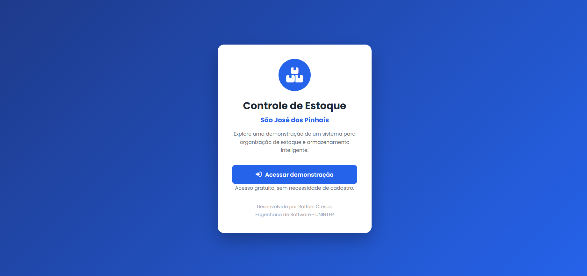
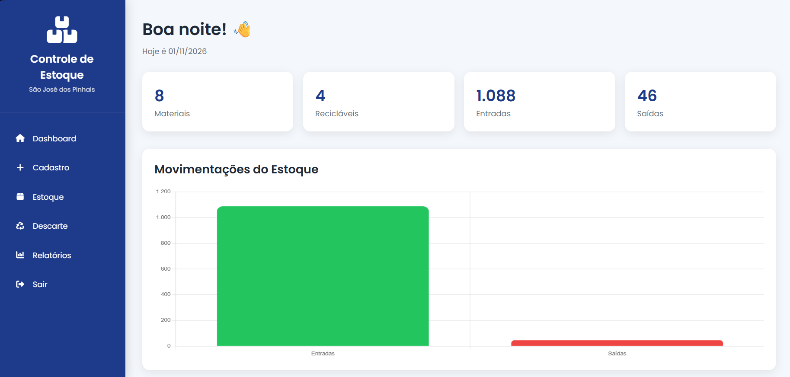
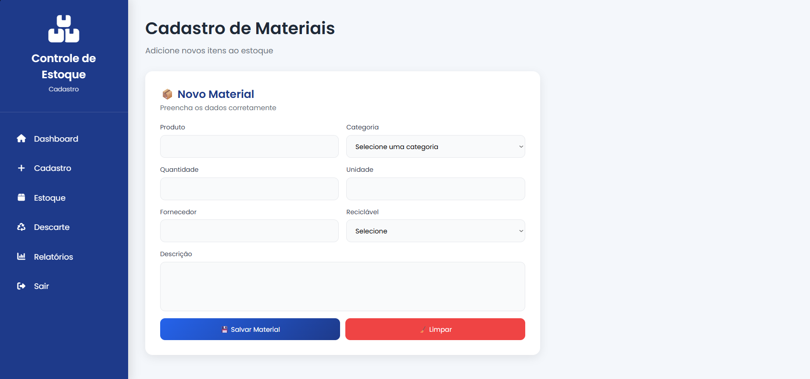
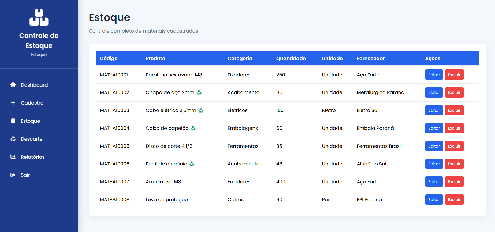
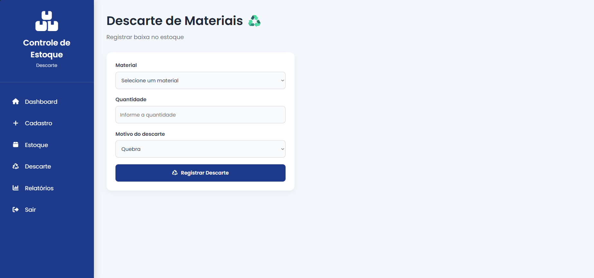
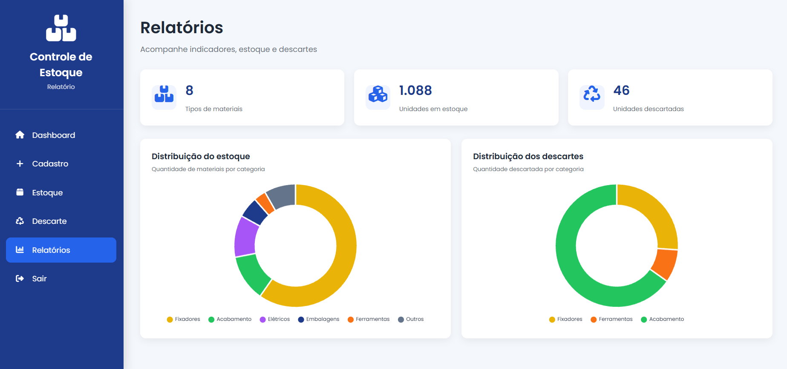

# Controle de Estoque São José dos Pinhais

Sistema web de gerenciamento de estoque desenvolvido como projeto acadêmico e de portfólio, com foco no controle de materiais, acompanhamento de quantidades e registro de descartes.

## Sobre o projeto

A aplicação permite gerenciar materiais, acompanhar o estoque disponível, registrar descartes e visualizar indicadores por meio de um dashboard.

Esta versão foi desenvolvida para funcionar de forma independente, utilizando o armazenamento local do navegador (`localStorage`), sem necessidade de autenticação, banco de dados externo ou serviços Firebase.

O sistema possui dados fictícios para facilitar a demonstração de suas funcionalidades.

## Demonstração visual

### Tela inicial

### Dashboard

### Cadastro de materiais

### Estoque

### Registro de descarte

### Relatórios

## Funcionalidades

- Cadastro de materiais.
- Consulta dos materiais em estoque.
- Edição e exclusão de registros.
- Registro de descarte de materiais.
- Atualização automática das quantidades após descartes.
- Validação da quantidade disponível antes de registrar descartes.
- Dashboard com indicadores.
- Relatórios gráficos por categoria.
- Armazenamento e persistência dos dados no navegador.

## Tecnologias utilizadas

- HTML5
- CSS3
- JavaScript
- localStorage
- Chart.js
- Font Awesome

## Armazenamento de dados

O projeto utiliza a API `localStorage` do navegador para armazenar os registros da aplicação.

Essa abordagem permite manter os dados salvos após atualizar ou fechar a página, sem depender de um servidor de banco de dados.

**Limitações do armazenamento local:**

- Os dados ficam vinculados ao navegador e à origem utilizada.
- Não existe sincronização automática entre dispositivos ou navegadores.
- A limpeza dos dados do navegador pode apagar os registros armazenados.
- A demonstração utiliza dados fictícios.

## Como executar o projeto

1. Baixe ou clone este repositório.
2. Abra a pasta do projeto no Visual Studio Code.
3. Abra o arquivo `index.html` utilizando a extensão Live Server.
4. A aplicação será aberta no navegador.

Não é necessário configurar Firebase, instalar dependências de backend ou criar um banco de dados.

*Observação: a biblioteca Chart.js e outros recursos externos podem precisar de conexão com a internet para serem carregados.*

## Objetivo

O projeto tem como objetivo aplicar conhecimentos de desenvolvimento web, manipulação do DOM, operações CRUD, armazenamento local, validação de dados e visualização de informações em uma aplicação prática.

## Autor

Raffael Crespo